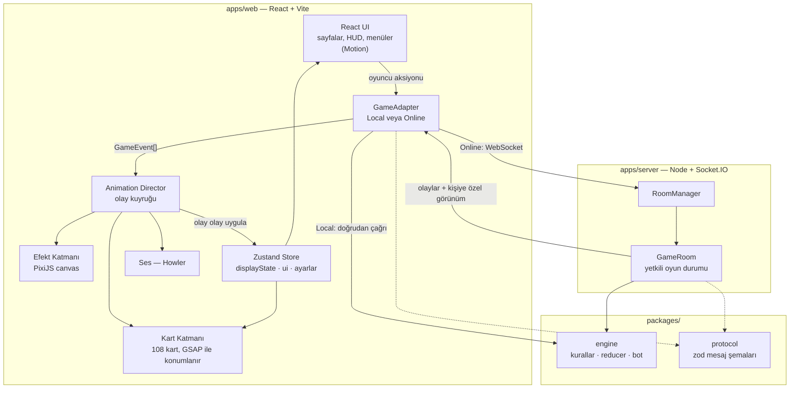
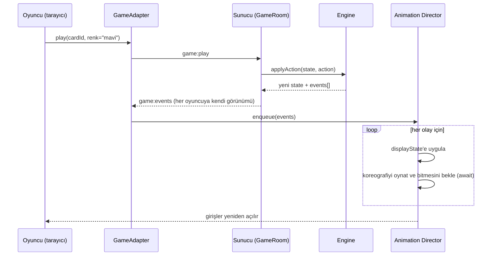

# UNO Web — Araştırma, Mimari ve Teknoloji Planı

> Amaç: Tarayıcıda oynanan, **yoğun animasyonlu**, botlara karşı ve online çok oyunculu oynanabilen bir UNO oyunu.
> Hedef: Masaüstü + mobilde 60 FPS, her oyun anının kendine ait bir animasyonu olması.

---

## 0. Özet — Alınan Kararlar

| Konu | Karar |
|---|---|
| Render yaklaşımı | **Hibrit**: Kartlar ve arayüz DOM + CSS 3D, efektler (parçacık, şok dalgası) PixiJS WebGL katmanında |
| Framework | **React 19 + TypeScript + Vite** (SPA) |
| Arayüz animasyonları | **Motion** (`motion/react`, eski adıyla Framer Motion) |
| Oyun koreografisi | **GSAP** (timeline, MotionPath, SplitText, CustomEase; 2025'ten beri tüm eklentiler ücretsiz) |
| Efekt katmanı | **PixiJS v8** (+ `canvas-confetti` kazanma konfetisi için) |
| Vektör animasyon | **dotLottie** (hazır ikon/animasyonlar), **Rive** (opsiyonel: interaktif UNO butonu, avatarlar) |
| Ses | **Howler.js** (audio sprite) |
| State | **Zustand** (React dışından da erişilebilir → animasyon yöneticisi için şart) |
| Sunucu | **Node.js + Socket.IO**, sunucu yetkili (authoritative) |
| Oyun kuralları | Ortak paket `packages/engine` — saf TypeScript, hem tarayıcıda hem sunucuda çalışır |
| Monorepo | **npm workspaces** (npm zaten kurulu; istenirse pnpm'e geçilir) |
| Test | Vitest (kurallar), Playwright (uçtan uca) |
| Mimari desen | **Olay güdümlü animasyon**: Engine olay üretir → Animation Director sırayla oynatır → ekran güncellenir |

---

## 1. Kapsam

**v1 (MVP)**
- Botlara karşı tek oyunculu oyun (2–4 oyuncu, 3 zorluk)
- Online oda: link ile arkadaş davet etme (2–8 oyuncu), boş koltuklara bot
- Resmi kurallar + açılıp kapatılabilen ev kuralları (stacking, 7-0, jump-in…)
- Mobil uyumlu düzen (dikey ve yatay)
- Ses, titreşim (mobil), animasyon hız ayarı, azaltılmış hareket desteği

**v2 fikirleri**
- Hesaplar, istatistik, sıralama tablosu
- Kart temaları / masa temaları
- 3D masa (React Three Fiber)
- Turnuva modu

---

## 2. Render Yaklaşımı Araştırması

| Yaklaşım | Artıları | Eksileri | Karar |
|---|---|---|---|
| **DOM + CSS 3D transform** | React ile doğal; metin net; erişilebilir; responsive kolay; CSS `rotateY` ile gerçek kart çevirme; GPU hızlandırmalı `transform` | Yüzlerce parçacık için yavaş | ✅ Kartlar + arayüz |
| **Canvas/WebGL (PixiJS)** | Binlerce sprite/parçacık 60 FPS; shader, blend mode, glow | Menü, metin, form, erişilebilirlik zahmetli | ✅ Sadece efekt katmanı |
| **Oyun motoru (Phaser)** | Sahne, tween, ses, input hazır | HTML menüler/lobi/sohbet ile entegrasyon zor; kart oyunu için fazla | ❌ |
| **3D (Three.js / R3F)** | Gerçek 3D masa, ışık, gölge, "vay" etkisi | Ağır; mobilde performans riski; model/asset maliyeti | ⏳ v2 |

**Sonuç:** Toplam 108 kart var, ekranda aynı anda en fazla ~40 kart görünür. Bu sayı DOM için rahattır.
Yoğun parçacık efektleri ise ayrı bir PixiJS canvas'ına (tıklamaları engellemeyen, `pointer-events: none`) verilir.

---

## 3. Animasyon Kütüphaneleri Araştırması

| Kütüphane | Güçlü olduğu yer | Zayıf yanı | Rolü |
|---|---|---|---|
| **Motion** (`motion`) | React state'e bağlı animasyon, `whileHover`, `drag`, `AnimatePresence` (çıkış animasyonu), `layout`, spring fizik | Uzun, çok adımlı koreografiyi yönetmek zahmetli | ✅ Arayüz, hover, sürükleme, modallar, sayfa geçişi |
| **GSAP** | Timeline, Promise döndürme, global hız (`timeScale`), MotionPath (yay çizerek uçma), SplitText (harf animasyonu), CustomEase, Physics2D | React'te temizlik gerekir (`@gsap/react` → `useGSAP`) | ✅ Kart hareketleri: dağıtma, oynama, çekme, karıştırma |
| **PixiJS v8** | WebGL, `ParticleContainer`, filtreler (glow, blur, displacement) | Ayrı bir render dünyası | ✅ Kıvılcım, şok dalgası, renk dalgası, duman |
| **canvas-confetti** | ~3 KB, tek satırla konfeti | Sadece konfeti | ✅ Kazanma, lobiye katılma |
| **dotLottie** | LottieFiles'taki binlerce hazır animasyon | Etkileşim sınırlı | ✅ Taç, kupa, yükleniyor, ikonlar |
| **Rive** | State machine ile interaktif animasyon (hover/press/idle) | Rive editöründe tasarım gerekir | ⚪ Opsiyonel: UNO butonu, maskot |
| React Spring | Fizik tabanlı spring | Motion aynı işi görüyor, topluluk küçüldü | ❌ |
| Anime.js v4 | Hafif, güzel API | GSAP'in eklenti zenginliği yok | ❌ |
| View Transitions API | Sayfa geçişleri | Kart koreografisi için uygun değil | ⚪ Belki sayfa geçişlerinde |
| tsParticles | Hazır parçacık arka planları | Pixi ile çakışır, ağır | ❌ |

### Görev dağılımı (çakışmayı önlemek için kesin kural)

> **Aynı DOM elementinin aynı özelliğini iki kütüphane asla birlikte animasyonlamaz.**

- **GSAP** → masadaki kartların konumu (`x`, `y`, `rotation`, `scale`) ve çevrilmesi (`rotateY`), oyun olayı koreografileri
- **Motion** → kullanıcı etkileşimi (hover, seçme, sürükleme, geçersiz kart titremesi), menüler, modallar, toast, sayfa geçişleri
- **PixiJS** → sadece kendi canvas'ı içindeki efektler
- **CSS** → sürekli ve basit döngüler (kart parlama/holo efekti, arka plan gradient kayması)

---

## 4. Teknoloji Yığını

| Katman | Seçim | Neden |
|---|---|---|
| Dil | TypeScript | Kurallar ve ağ mesajları istemci-sunucu arasında ortak tipte |
| Build | Vite | Çok hızlı HMR, SPA için ideal; SSR'a ihtiyaç yok |
| UI | React 19 | Motion ve Pixi'nin React entegrasyonları olgun |
| Stil | Tailwind CSS v4 + CSS değişkenleri | Hızlı geliştirme; masa rengi `--table-color` değişkeniyle animasyonlanır |
| State | Zustand | Basit; Animation Director React dışından `getState()` ile erişir |
| Yönlendirme | React Router | Ana sayfa / Lobi / Oyun |
| UI animasyon | Motion | Bkz. bölüm 3 |
| Koreografi | GSAP + `@gsap/react` | Bkz. bölüm 3 |
| Efekt | PixiJS v8 + `@pixi/react` | Bkz. bölüm 3 |
| Konfeti | canvas-confetti | Bkz. bölüm 3 |
| Vektör anim. | `@lottiefiles/dotlottie-react`, (ops.) `@rive-app/react-canvas` | Hazır, hafif animasyonlar |
| Ses | Howler.js | Audio sprite, mobil ses kilidi çözümü, aynı anda çoklu ses |
| İkon | lucide-react | Temiz SVG ikonlar |
| Sunucu | Node.js + Socket.IO | Oda (room) desteği, otomatik yeniden bağlanma, basit API |
| Doğrulama | Zod | İstemciden gelen her mesaj sunucuda doğrulanır |
| Test | Vitest, Playwright | Kurallar saf fonksiyon → kolay test |
| Deploy | Web: Vercel / Netlify / Cloudflare Pages · Sunucu: Fly.io / Railway / Render | Sunucu kalıcı WebSocket tuttuğu için serverless olmamalı |

**Değerlendirilip elenenler**
- **Next.js**: Oyun bir SPA; SSR, Pixi/GSAP ile ek karmaşıklık getirir. Tanıtım sayfası gerekirse ayrıca eklenir.
- **Colyseus**: Oyun sunucusu çatısı olarak güzel, ama gizli el kartları için şema filtreleri karmaşıklaştırıyor. Socket.IO + kendi "oyuncuya özel görünüm" fonksiyonumuz daha sade. Eşleştirme (matchmaking) gerekirse geçilebilir.

---

## 5. Mimari Şema

### 5.1 Genel yapı



### 5.2 Bir kartın oynanması (online)



### 5.3 Ekran katmanları (z-index)

```
 z 50  Overlay        → renk çarkı, modallar, kazanma ekranı        (Motion)
 z 40  Efekt canvas   → PixiJS parçacıklar, pointer-events: none    (PixiJS)
 z 30  HUD            → avatarlar, süre halkası, UNO butonu, sohbet (Motion)
 z 20  Kart katmanı   → 108 kartın hepsi tek katmanda               (GSAP + Motion)
 z 10  Masa öğeleri   → deste yeri, yön halkası                      (GSAP)
 z  0  Arka plan      → masa gradient'i, renk geçişi                (CSS değişkeni)
```

### 5.4 Ekran düzeni (masaüstü)

```
+--------------------------------------------------------------+
| [Menü]               Rakip 2 (5 kart)          [Ayar] [Sohbet]|
|                                                              |
|  Rakip 1               .-----------------.          Rakip 3  |
|  (7 kart)              |   ( yön halkası )  |       (3 kart)  |
|                        |  [DESTE]  [ATILAN] |                 |
|                        '-----------------'                   |
|                                                              |
|              /  [k] [k] [k] [k] [k] [k] [k]  \               |
|                   (senin elin — yelpaze)                     |
| [avatar + süre halkası]                          [  UNO!  ]  |
+--------------------------------------------------------------+
```
Mobilde: rakipler üstte yatay şerit, el altta kaydırılabilir yelpaze, UNO butonu sağ altta.

---

## 6. Çekirdek Desen: Olay Güdümlü Animasyon

Animasyonlu kart oyunlarının en çok bozulduğu yer: **state anında değişir ama animasyon zaman alır.**
Çözüm iki ayrı durum tutmak:

- **truthState**: Engine'in/sunucunun söylediği gerçek durum (anında güncellenir)
- **displayState**: Ekranda gösterilen durum — Director olayları **tek tek** uygular, her birinin animasyonunu bitmesini bekler

Engine her aksiyonda bir **olay listesi** döndürür. Örneğin "+4 oynandı" tek bir state değişikliği değil, şu olaylardır:
`CARD_PLAYED → COLOR_CHOSEN → PENALTY_DRAW(4) → PLAYER_SKIPPED → TURN_CHANGED`
Her olayın kendi koreografisi vardır ve sırayla oynar.

```ts
// packages/engine/src/events.ts
export type GameEvent =
  | { type: 'GAME_STARTED'; playerIds: string[]; dealerId: string }
  | { type: 'DECK_SHUFFLED' }
  | { type: 'CARDS_DEALT'; hands: Record<string, { count: number; cards?: Card[] }> }
  | { type: 'FIRST_CARD_FLIPPED'; card: Card }
  | { type: 'CARD_PLAYED'; playerId: string; card: Card; handIndex: number }
  | { type: 'CARD_DRAWN'; playerId: string; count: number; cards?: Card[] } // cards sadece sahibine gider
  | { type: 'COLOR_CHOSEN'; playerId: string; color: Color }
  | { type: 'DIRECTION_REVERSED'; direction: 1 | -1 }
  | { type: 'PLAYER_SKIPPED'; playerId: string }
  | { type: 'PENALTY_DRAW'; playerId: string; count: number; stacked: number }
  | { type: 'UNO_CALLED'; playerId: string }
  | { type: 'UNO_CAUGHT'; catcherId: string; targetId: string }
  | { type: 'DISCARD_RESHUFFLED'; count: number }
  | { type: 'TURN_CHANGED'; playerId: string; deadline: number }
  | { type: 'ROUND_ENDED'; winnerId: string; points: number; scores: Record<string, number> };
```

```ts
// apps/web/src/animation/director.ts  (taslak)
class AnimationDirector {
  private queue: GameEvent[] = [];
  private running = false;

  enqueue(events: GameEvent[]) {
    this.queue.push(...events);
    if (!this.running) void this.run();
  }

  private async run() {
    this.running = true;
    const store = useGameStore.getState();
    store.setInputLocked(true);
    while (this.queue.length) {
      const event = this.queue.shift()!;
      store.applyEvent(event);                       // kart yeni bölgesine (zone) geçer
      const play = choreographies[event.type];
      if (play && !this.shouldSkip()) await play(event, ctx); // GSAP/Pixi/ses → Promise
    }
    store.setInputLocked(false);
    this.running = false;
  }

  // Sekme arka plandaysa veya animasyonlar kapalıysa birikmiş olayları anında uygula
  private shouldSkip() {
    return document.hidden || useSettings.getState().animationSpeed === 0;
  }
}
```

Animasyon hızı ayarı (0.5x / 1x / 2x / Kapalı) tek satır: `gsap.globalTimeline.timeScale(speed)`.

---

## 7. Kart Katmanı Tasarımı

### 7.1 Tek katman, kalıcı kartlar
108 kartın her biri, oyun boyunca **hiç unmount olmayan** tek bir `<Card>` elementidir ve tek bir `CardLayer` içinde mutlak konumlanır.
Kartın hangi bölgede olduğu (deste, atılan yığın, oyuncu eli + sıra) store'da tutulur. Bir **layout fonksiyonu** bölgeden hedef konumu hesaplar:

```ts
// apps/web/src/animation/layout.ts
type Zone =
  | { kind: 'deck'; index: number }
  | { kind: 'discard'; index: number }
  | { kind: 'hand'; playerId: string; index: number; total: number };

type CardTransform = { x: number; y: number; rotation: number; scale: number; faceUp: boolean; z: number };

function layoutCard(zone: Zone, seats: SeatMap, viewport: Size): CardTransform;
```
- **El yelpazesi**: kart sayısına göre açı aralığı `min(60°, n × 6°)`, her kart yay üzerinde (`cos`) hafif aşağı iner
- **Koltuklar**: 2–8 oyuncu bir elips etrafına dizilir; kendi koltuğun her zaman altta
- **Atılan yığın**: kart id'sinden türetilen sabit rastgele açı (±15°), böylece yığın doğal görünür

Kart bölge değiştirdiğinde element aynı kalır; GSAP eski konumdan yeni hedefe animasyon yapar. Bu yaklaşım sayesinde **her hareket otomatik olarak animasyonlanabilir.**

### 7.2 İç içe 4 katmanlı kart elementi

| Katman | Element | Sahibi | Animasyonlanan |
|---|---|---|---|
| 1 | `CardSlot` | GSAP (Director) | `x`, `y`, `rotation`, `scale`, `zIndex` |
| 2 | `CardInteract` | Motion | hover'da yukarı kalkma, `scale`, sürükleme, geçersiz kart titremesi |
| 3 | `CardFlipper` | GSAP | `rotateY` 0° ↔ 180° (`transform-style: preserve-3d`) |
| 4 | `CardFront` / `CardBack` | CSS | parlama / holo efekti, `backface-visibility: hidden` |

### 7.3 Kart görselleri
108 ayrı resim yerine **tek bir SVG tabanlı React bileşeni** (`<CardFace color value />`): her boyutta net, çok küçük, tema değiştirilebilir.
Renk körü modu için her rengin ayrı bir sembolü/deseni olur (UNO tamamen renge dayalı olduğu için önemli).

---

## 8. Oyun Motoru (`packages/engine`)

Saf TypeScript, DOM'a ve ağa bağımlılığı yok → hem tarayıcıda (bot oyunu) hem sunucuda çalışır, kolayca test edilir.

### 8.1 Kart modeli ve deste (108 kart)

```ts
export type Color = 'red' | 'yellow' | 'green' | 'blue';
export type Value =
  | '0' | '1' | '2' | '3' | '4' | '5' | '6' | '7' | '8' | '9'
  | 'skip' | 'reverse' | 'draw2' | 'wild' | 'wild4';
export type Card = { id: string; color: Color | 'wild'; value: Value };
```

| Kart | Renk başına | Toplam |
|---|---|---|
| 0 | 1 | 4 |
| 1–9 | her biri 2 | 72 |
| Atla (Skip) | 2 | 8 |
| Yön Değiştir (Reverse) | 2 | 8 |
| +2 | 2 | 8 |
| Renk Seç (Wild) | — | 4 |
| +4 Renk Seç | — | 4 |
| **Toplam** | | **108** |

### 8.2 API

```ts
createGame(config: GameConfig, seed: string): GameState
applyAction(state: GameState, action: Action, actorId: string):
  { ok: true; state: GameState; events: GameEvent[] } | { ok: false; error: RuleError }
getPlayableCardIds(state: GameState, playerId: string): string[]
toPlayerView(state: GameState, playerId: string): PlayerView   // diğer ellerin sadece sayısı görünür
chooseBotAction(view: PlayerView, difficulty: 'easy' | 'normal' | 'hard'): Action
scoreHand(cards: Card[]): number
```

**Aksiyonlar:** `PLAY { cardId, chosenColor? }`, `DRAW`, `PASS`, `CALL_UNO`, `CATCH_UNO { targetId }`, `CHALLENGE_WILD4`, `TIMEOUT`

**Durum (özet):** oyuncular + elleri, çekme destesi, atılan yığın, geçerli renk, sıradaki oyuncu, yön (1 / -1), bekleyen ceza (stacking için), faz (`dealing | playing | choosingColor | roundOver`), kurallar, RNG durumu.

### 8.3 Resmi kural notları
- Renk **veya** sayı/sembol eşleşmesi gerekir; Wild her zaman oynanabilir
- +4 yalnızca elde eşleşen renk yokken oynanabilir (itiraz/challenge kuralı opsiyonel)
- 2 kişilik oyunda Reverse = Atla
- İlk açılan kart: +4 ise desteye geri karıştırılır; Wild ise ilk oyuncu renk seçer; Skip/Reverse/+2 normal etkisini uygular
- Tek kart kalınca "UNO" demeyen oyuncu yakalanırsa 2 kart çeker
- Puanlama: sayılar kendi değeri, Skip/Reverse/+2 = 20, Wild/+4 = 50; 500 puana ulaşan kazanır

### 8.4 Ev kuralları (ayarlanabilir)
`stacking` (+2 üstüne +2, +4 üstüne +4), `sevenZero` (7 → el takası, 0 → eller döner), `jumpIn` (aynı kartla sıra beklemeden atlama), `drawUntilPlayable`, `forcePlay`, `challengeWild4`, `turnTimerSeconds`

### 8.5 Deterministik RNG
Karıştırma, seed'li bir RNG ile yapılır (ör. mulberry32). Aynı seed → aynı oyun: testler tekrarlanabilir, hatalar yeniden oluşturulabilir, ileride oyun tekrarı (replay) mümkün olur. Online oyunda seed **sadece sunucuda** bulunur.

---

## 9. Ağ Protokolü

### 9.1 GameAdapter — UI'ın oyun kaynağını bilmemesi için

```ts
interface GameAdapter {
  start(): Promise<void>;
  send(action: Action): void;
  onEvents(cb: (events: GameEvent[], view: PlayerView) => void): () => void;
  dispose(): void;
}
```
- `LocalGameAdapter` → engine'i tarayıcıda çalıştırır, botlar "düşünme süresi" ile (`setTimeout`) oynar
- `OnlineGameAdapter` → `socket.io-client` ile sunucuya bağlanır

UI ve Director iki modda da **aynı** kodu kullanır.

### 9.2 Mesajlar (`packages/protocol`, zod ile doğrulanır)

| Yön | Mesaj | İçerik |
|---|---|---|
| İstemci → Sunucu | `room:create` | `{ name, rules }` |
| İstemci → Sunucu | `room:join` | `{ roomCode, name }` |
| İstemci → Sunucu | `room:addBot` / `room:kick` | `{ seat }` |
| İstemci → Sunucu | `game:start` | — |
| İstemci → Sunucu | `game:action` | `Action` |
| İstemci → Sunucu | `chat:send` / `chat:emoji` | `{ text }` / `{ emoji }` |
| Sunucu → İstemci | `room:state` | oyuncular, koltuklar, kurallar, host |
| Sunucu → İstemci | `game:events` | `{ events: GameEvent[], view: PlayerView, seq }` |
| Sunucu → İstemci | `game:sync` | yeniden bağlanınca tam görünüm |
| Sunucu → İstemci | `error` | `{ code, message }` |

### 9.3 Güvenlik
- Sunucu yetkilidir: her aksiyon engine'de doğrulanır, istemciye asla güvenilmez
- Rakiplerin kartları ve deste sırası **asla** istemciye gönderilmez (`toPlayerView`)
- `seq` numarası ile kaçırılan olay fark edilirse `game:sync` istenir
- Bağlantı koparsa koltuk 60 sn tutulur, sonra bot devralır

---

## 10. Dosya Yapısı

```
uno/
├─ package.json                 # npm workspaces kökü
├─ tsconfig.base.json
├─ PLAN.md                      # bu doküman
│
├─ packages/
│  ├─ engine/                   # saf oyun kuralları (tarayıcı + sunucu)
│  │  ├─ src/
│  │  │  ├─ cards.ts            # Card, Color, Value tipleri, 108'lik deste üretimi
│  │  │  ├─ rng.ts              # seed'li RNG + karıştırma
│  │  │  ├─ rules.ts            # oynanabilirlik, kart etkileri, ev kuralları
│  │  │  ├─ reducer.ts          # applyAction → { state, events }
│  │  │  ├─ events.ts           # GameEvent tipleri
│  │  │  ├─ view.ts             # toPlayerView (gizli bilgi filtreleme)
│  │  │  ├─ scoring.ts
│  │  │  ├─ bot.ts              # bot karar mantığı (3 zorluk)
│  │  │  └─ index.ts
│  │  └─ test/                  # Vitest: kurallar, özel kartlar, kenar durumlar
│  │
│  └─ protocol/
│     └─ src/messages.ts        # zod şemaları + tipler
│
├─ apps/
│  ├─ web/
│  │  ├─ index.html
│  │  ├─ vite.config.ts
│  │  ├─ public/
│  │  │  ├─ sounds/             # sprite.mp3 + sprite.json (flip, deal, slap, uno, win…)
│  │  │  ├─ lottie/             # crown.lottie, trophy.lottie, loading.lottie
│  │  │  └─ textures/           # Pixi parçacık dokuları (spark.png, ring.png)
│  │  └─ src/
│  │     ├─ main.tsx
│  │     ├─ App.tsx             # router + MotionConfig + AnimatePresence
│  │     ├─ routes/
│  │     │  ├─ HomePage.tsx     # açılış animasyonu, "Botlarla oyna" / "Oda kur"
│  │     │  ├─ LobbyPage.tsx    # oda kodu, koltuklar, kurallar
│  │     │  └─ GamePage.tsx     # masa
│  │     ├─ components/
│  │     │  ├─ card/
│  │     │  │  ├─ Card.tsx          # 4 katmanlı kart (Slot/Interact/Flipper/Faces)
│  │     │  │  ├─ CardFace.tsx      # SVG ön yüz
│  │     │  │  ├─ CardBack.tsx      # SVG arka yüz
│  │     │  │  └─ card.css          # 3D flip, holo/parlama
│  │     │  ├─ table/
│  │     │  │  ├─ Table.tsx         # katmanları birleştirir
│  │     │  │  ├─ CardLayer.tsx     # 108 kartı tek katmanda render eder
│  │     │  │  ├─ PlayerSeat.tsx    # avatar, kart sayısı, süre halkası
│  │     │  │  ├─ DirectionRing.tsx
│  │     │  │  └─ TurnTimer.tsx     # SVG geri sayım halkası
│  │     │  ├─ hud/
│  │     │  │  ├─ UnoButton.tsx
│  │     │  │  ├─ ColorPicker.tsx   # radyal renk çarkı
│  │     │  │  ├─ Scoreboard.tsx
│  │     │  │  ├─ ChatPanel.tsx
│  │     │  │  └─ EmojiReactions.tsx
│  │     │  └─ ui/                  # Button, Modal, Toast, Toggle, Slider
│  │     ├─ animation/
│  │     │  ├─ director.ts          # olay kuyruğu
│  │     │  ├─ layout.ts            # bölge → konum hesapları (yelpaze, koltuklar)
│  │     │  ├─ registry.ts          # kart id → DOM ref haritası
│  │     │  ├─ presets.ts           # süreler, easing'ler, spring ayarları
│  │     │  ├─ gsapSetup.ts         # eklenti kaydı, CustomEase tanımları
│  │     │  └─ choreographies/
│  │     │     ├─ index.ts          # event.type → koreografi eşlemesi
│  │     │     ├─ shuffle.ts
│  │     │     ├─ deal.ts
│  │     │     ├─ playCard.ts
│  │     │     ├─ drawCard.ts
│  │     │     ├─ chooseColor.ts
│  │     │     ├─ reverse.ts
│  │     │     ├─ skip.ts
│  │     │     ├─ penaltyDraw.ts
│  │     │     ├─ uno.ts
│  │     │     ├─ reshuffle.ts
│  │     │     └─ roundEnd.ts
│  │     ├─ effects/
│  │     │  ├─ EffectsCanvas.tsx    # PixiJS uygulaması (lazy load)
│  │     │  ├─ particles.ts         # sparks(), shockwave(), colorWave(), smoke()
│  │     │  ├─ confetti.ts          # canvas-confetti sarmalayıcı
│  │     │  └─ screenShake.ts
│  │     ├─ audio/
│  │     │  └─ sound.ts             # Howler sprite, ses seviyesi, mobil kilit açma
│  │     ├─ store/
│  │     │  ├─ gameStore.ts         # displayState, applyEvent, inputLocked
│  │     │  ├─ uiStore.ts           # seçili kart, açık modal
│  │     │  └─ settingsStore.ts     # ses, animasyon hızı, renk körü modu (localStorage)
│  │     ├─ net/
│  │     │  ├─ GameAdapter.ts
│  │     │  ├─ LocalGameAdapter.ts
│  │     │  └─ OnlineGameAdapter.ts
│  │     ├─ hooks/                  # useViewport, useReducedMotion, useKeyboardControls
│  │     └─ styles/
│  │        ├─ globals.css          # Tailwind + tema değişkenleri
│  │        └─ theme.css            # renkler, gölgeler
│  │
│  └─ server/
│     └─ src/
│        ├─ index.ts                # HTTP + Socket.IO sunucusu
│        ├─ RoomManager.ts          # oda kodu üretme, odaları tutma, temizlik
│        ├─ GameRoom.ts             # tek odanın yetkili oyun durumu, zamanlayıcı
│        ├─ handlers.ts             # mesaj → zod doğrulama → GameRoom
│        └─ botRunner.ts            # boş koltuklarda engine/bot.ts çalıştırır
│
└─ e2e/                             # Playwright testleri
```

---

## 11. Animasyon Haritası

Her oyun anı → ne olacak → hangi araç → süre → ses

| # | An | Animasyon | Araç | Süre | Ses |
|---|---|---|---|---|---|
| 1 | Açılış ekranı | Logo harfleri tek tek düşüp zıplar; arka planda yüzen kartlar fareyle paralaks yapar | GSAP SplitText, Motion | 1.2 sn | whoosh |
| 2 | Sayfa geçişleri | Kayma + bulanıklık geçişi | Motion `AnimatePresence` | 0.4 sn | — |
| 3 | Lobiye oyuncu katılması | Avatar yay ile belirir, küçük konfeti | Motion spring, canvas-confetti | 0.5 sn | pop |
| 4 | Oyun başı karıştırma | Deste ikiye ayrılır, kartlar iç içe geçer (riffle), toparlanır | GSAP timeline | 1.0 sn | shuffle |
| 5 | Dağıtma | Kartlar desteden her koltuğa yay çizerek sırayla uçar; senin elindekiler varınca açılır | GSAP MotionPath + stagger | ~2 sn | tık tık |
| 6 | İlk kartın açılması | Desteden ortaya uçar, havada döner, parıltı | GSAP + Pixi sparks | 0.5 sn | flip |
| 7 | El düzeni | Kart sayısı değişince yelpaze yumuşakça yeniden düzenlenir | GSAP stagger | 0.25 sn | — |
| 8 | Hover / seçme | Kart yukarı kalkar, komşular hafif yana açılır, kenar parlar | Motion `whileHover` + spring | spring | hafif tık |
| 9 | Oynanamaz kart | Hafif gri; tıklanırsa sağa-sola titrer | Motion | 0.3 sn | bzzt |
| 10 | Sen kart oynarsın | Kart yay çizerek uçar, dönerek yığına "çarpar" (squash), kıvılcım + şok dalgası, yığın hafif sarsılır | GSAP MotionPath + Pixi | 0.45 sn | şak |
| 11 | Rakip kart oynar | Kart rakibin koltuğundan çıkar, havada arkadan öne döner, aynı iniş | GSAP + Pixi | 0.55 sn | şak |
| 12 | Kart çekme | Desteden kayar; senin elinse havada açılıp yelpazeye yerleşir | GSAP | 0.4 sn | çekme |
| 13 | Renk seçimi (Wild) | Radyal renk çarkı 4 dilim halinde açılır; seçilen renk masaya dalga gibi yayılır, kart o renge boyanır | Motion + CSS değişkeni + Pixi colorWave | 0.8 sn | sihir |
| 14 | Yön değiştirme | Ortadaki yön halkası 180° döner, oklar ters akar, kartın üstünde dev ↺ belirip söner | GSAP | 0.7 sn | swoosh |
| 15 | Atlama (Skip) | Atlanan oyuncunun avatarına ⊘ damgası iner (büyükten küçüğe, zıplama), avatar grileşir, ekran hafif sarsılır | GSAP + screenShake | 0.6 sn | güm |
| 16 | +2 / +4 | Kartın üstünde dev "+2/+4" yazısı patlar, kurbanın avatarı kırmızı yanıp titrer, ceza kartları art arda uçar; stacking'de sayaç rozeti büyür | GSAP SplitText + Pixi | 0.8 sn+ | alarm |
| 17 | Sıra göstergesi | Aktif avatarda dönen ışık halkası + SVG geri sayım; son 5 sn kırmızı nabız | CSS + GSAP | sürekli | tik (son 5 sn) |
| 18 | UNO butonu | Tek kart kalınca nabız atar; basılınca "UNO!" harfleri patlar + parçacık yağmuru | Motion / Rive + GSAP SplitText + Pixi | 1.0 sn | "UNO!" |
| 19 | UNO yakalama | "Yakalandın!" bandı kayarak girer, 2 ceza kartı uçar | Motion + GSAP | 0.8 sn | düdük |
| 20 | Deste biterse | Atılan kartlar (üstteki hariç) desteye süpürülür, arkaya döner, karıştırılır | GSAP | 1.2 sn | shuffle |
| 21 | Tur sonu / kazanma | Kazananın avatarı büyür, taç düşer, konfeti yağar, kalan kartlar ortaya uçar, puan sayacı yükselir | Lottie + canvas-confetti + GSAP | ~3 sn | fanfar |
| 22 | Emoji tepkileri | Emoji koltuktan yukarı süzülüp kaybolur | Motion | 1.5 sn | pop |
| 23 | Bağlantı koptu | Avatar soluklaşır, toast belirir | Motion | 0.3 sn | — |
| 24 | Masa arka planı | Geçerli renge göre gradient yavaşça kayar | CSS | sürekli | — |

---

## 12. Performans ve Erişilebilirlik Kuralları

**Performans**
- Sadece `transform` ve `opacity` animasyonlanır (`filter` idareli); `top/left/width` asla
- `will-change: transform` yalnızca animasyon sırasında eklenir
- Tek bir Pixi canvas'ı; parçacık sayısına üst sınır (~300); boşta ticker durdurulur
- Pixi, Lottie ve Rive **lazy load** (`import()`), ilk yükleme hafif kalır
- Sekme arka plandayken Director birikmiş olayları animasyonsuz uygular
- React StrictMode'da GSAP temizliği için `useGSAP` kullanılır
- Safari'de 3D çevirme için `-webkit-backface-visibility: hidden` eklenir
- Test cihazı: orta segment Android (Chrome) + iPhone (Safari)

**Erişilebilirlik**
- `prefers-reduced-motion`: Director kısa/solma versiyonlarını kullanır; `<MotionConfig reducedMotion="user">`, GSAP `matchMedia()`
- Ayarlar: animasyon hızı (0.5x / 1x / 2x / Kapalı), ses, titreşim
- Renk körü modu: her renge sembol/desen
- Klavye: ←/→ kart seç, Enter oyna, D çek, U "UNO"
- Kartlarda ARIA etiketi ("Kırmızı 7", "Mavi +2")

---

## 13. Yol Haritası

| Faz | İş | Bitti sayılır… |
|---|---|---|
| 0 | Kurulum: workspaces, TypeScript, Vite, Tailwind, Vitest, ESLint/Prettier | `npm run dev` boş sayfa açar, `npm test` çalışır |
| 1 | Engine: deste, kurallar, reducer, olaylar, görünüm, bot | Tüm kurallar ve özel kartlar test edilmiş; botlar kendi aralarında 1000 oyunu hatasız bitirir |
| 2 | Statik masa: SVG kartlar, layout, koltuklar, LocalGameAdapter | Botlara karşı animasyonsuz ama oynanabilir tam oyun |
| 3 | Director + temel koreografiler: dağıtma, oynama, çekme, çevirme, hover, yelpaze | Kart hareketlerinin tamamı animasyonlu, hız ayarı çalışıyor |
| 4 | Özel kart animasyonları + Pixi efekt katmanı + ses | Bölüm 11'deki tablo eksiksiz |
| 5 | Online: sunucu, odalar, davet linki, yeniden bağlanma, sohbet/emoji | 2 tarayıcıda online oyun sonuna kadar oynanır |
| 6 | Cilalama: mobil düzen, reduced motion, renk körü modu, performans ölçümü | Orta segment telefonda 60 FPS'e yakın |
| 7 | Yayın: web + sunucu deploy, alan adı | Herkese açık link ile oynanabilir |

---

## 14. Riskler ve Notlar

- **Marka**: "UNO" Mattel'in tescilli markasıdır. Kişisel/öğrenme projesi için sorun yok; herkese açık yayında orijinal logo ve kart tasarımı kullanılmamalı, farklı bir isim düşünülmeli.
- **Mobil performans**: Aynı anda çok animasyon + Pixi → düşük cihazlarda "düşük efekt" modu (parçacıklar kapalı).
- **Gizli bilgi sızıntısı**: Tam state'i istemciye göndermek en sık yapılan hata → sadece `toPlayerView`.
- **Olay birikmesi**: Online oyunda arka plandaki sekme dönünce onlarca animasyon oynatmamalı → hızlı ileri sarma.
- **İki kütüphane çakışması**: Bölüm 3'teki görev dağılımı kuralına uyulmalı.

---

## 15. İlk Kurulum Komutları (Faz 0)

```bash
# kök
npm init -y
# package.json içine: "workspaces": ["apps/*", "packages/*"]

# web uygulaması
npm create vite@latest apps/web -- --template react-ts
npm i -w apps/web motion gsap @gsap/react zustand react-router pixi.js @pixi/react howler canvas-confetti @lottiefiles/dotlottie-react lucide-react socket.io-client
npm i -D -w apps/web tailwindcss @tailwindcss/vite @types/howler @types/canvas-confetti

# sunucu
npm i -w apps/server socket.io zod
npm i -D -w apps/server tsx typescript @types/node

# ortak paketler
npm i -w packages/protocol zod
npm i -D -w packages/engine vitest typescript
```
> Not: Paket sürümleri kurulum anında `latest` olarak alınır; büyük sürüm değişiklikleri (ör. Pixi v8 API'si) kod yazarken dokümanlardan kontrol edilir.
