<div align="center">

# 🃏 UNO 3D

**Arkadaşlarınla masaya otur, kartları at.**

### [▶ Hemen oyna: yusufesan.github.io/uno3d](https://yusufesan.github.io/uno3d/)

Tarayıcıda oynanan, 3D bir masada geçen online UNO. Karakterler gerçek animasyonlarla masada oturur, kartlar ellerinden savrularak yığına uçar; sen de birinci şahıs gözünden elindeki kartlara bakarsın.

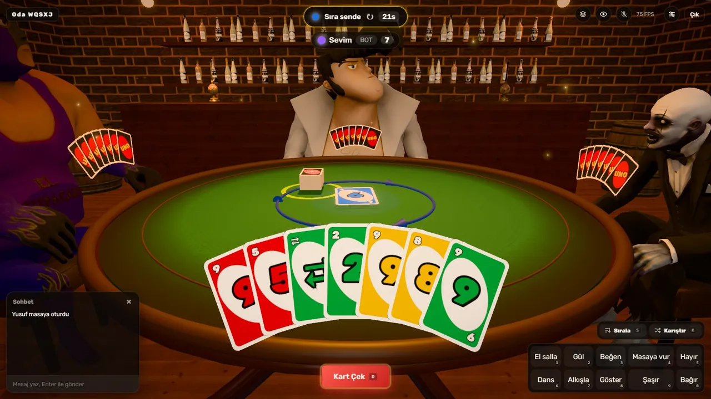

</div>

---

## İçindekiler

- [Öne çıkanlar](#öne-çıkanlar)
- [Nasıl oynanır](#nasıl-oynanır)
- [Masa temaları](#masa-temaları)
- [Kontroller](#kontroller)
- [Kurulum ve çalıştırma](#kurulum-ve-çalıştırma)
- [Proje yapısı](#proje-yapısı)
- [Teknolojiler ve emeği geçenler](#teknolojiler-ve-emeği-geçenler)

---

## Öne çıkanlar

- 🌐 **Online çok oyunculu.** Oda kur, davet linkini paylaş, 4 kişiye kadar aynı masada oyna. Hızlı Oyun ile tek tıkla eşleş.
- 🤖 **Botlar.** Boş koltuklara Kolay, Normal ya da Zor bot ekle; tek başına da oynayabilirsin.
- 🎭 **Canlı karakterler.** Her oyuncuya rastgele, birbirinden farklı bir karakter düşer. Karakterler masaya bakar, sırası gelene döner, kartlarını elinde tutar ve atar.
- 👋 **Emote'lar.** El salla, gül, alkışla, masaya vur, dans et... Karakterin animasyonu masadaki herkese görünür.
- 🎙️ **Sesli sohbet ve yazılı sohbet.** Mikrofonu aç, konuşan oyuncunun ağzı hareket eder.
- 🏝️ **10 farklı masa teması.** Loş bir meyhaneden bulutların üstüne, uçağın kanadından tekne gezisine kadar.
- ⚙️ **Ev kuralları.** +2 / +4 üst üste atılabilir (ceza birikir), yeni gelenlerin odaya katılmasını oda sahibi onaylar; her hamle için 30 saniye süre vardır.
- 🚀 **Akıcı.** Grafik kalitesi cihaza göre otomatik ayarlanır; modeller ve gökyüzü ana ekrandayken arka planda yüklenir.

---

## Nasıl oynanır

### 1. Adını yaz, masaya otur

Ana ekranda adını yaz. **Hızlı Oyun** seni hazır bir masaya oturtur, **Özel Oda Kur** sadece senin ve arkadaşlarının olduğu bir oda açar. Arkadaşından gelen oda koduyla **Katıl** da diyebilirsin.

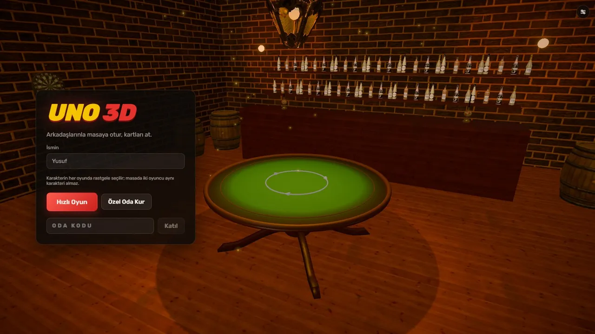

### 2. Lobide masayı hazırla

Oda sahibi masanın temasını seçer, boş koltuklara bot ekler, bot zorluğunu ve ev kurallarını belirler. **Davet linkini kopyala** ile arkadaşlarını çağır, herkes hazır olunca **Oyunu Başlat**.

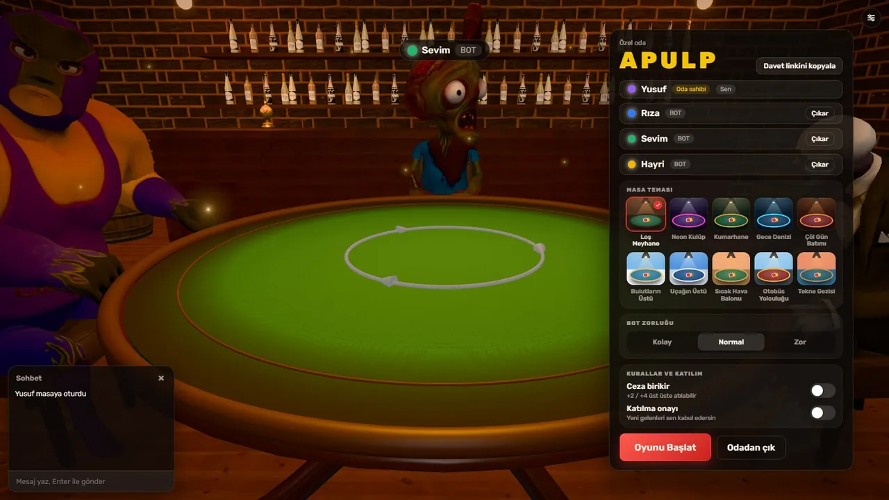

### 3. Kartlarını oyna

Herkese 7 kart dağıtılır. Sıra sendeyken ortadaki kartla **aynı renkte** ya da **aynı sayı/sembolde** bir kart at. Oynanabilir kartların öne çıkar; atacak kartın yoksa **Kart Çek**. Ekranın üstünde sıranın kimde olduğu ve kalan süre görünür.

| Kart | Etkisi |
|---|---|
| **0–9** | Renk ya da sayı eşleşmesiyle atılır |
| **⊘ Atla** | Sıradaki oyuncu bir tur bekler |
| **⇄ Yön Değiştir** | Oyunun yönü tersine döner |
| **+2** | Sıradaki oyuncu 2 kart çeker ve sırasını kaybeder |
| **Renk Seç** | Her zaman atılabilir; yeni rengi sen seçersin |
| **+4** | Rengi sen seçersin, sıradaki oyuncu 4 kart çeker |

> **Ceza birikir** kuralı açıksa +2'nin üstüne +2, +2 ya da +4'ün üstüne +4 atarak cezayı bir sonraki oyuncuya aktarabilirsin.

<p align="center">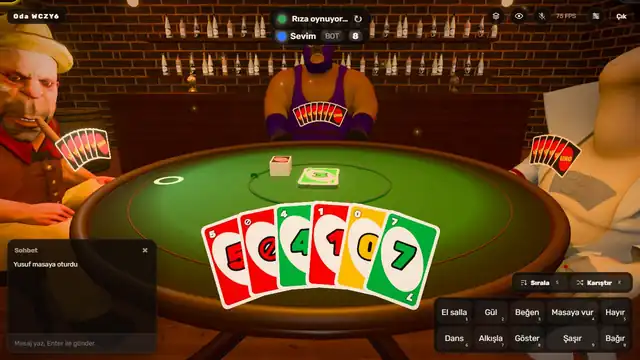</p>

Elinde tek kart kalınca **UNO!** otomatik söylenir. Elindeki kartları ilk bitiren eli kazanır; diğerlerinin kartları masaya açılır ve rövanş başlatılabilir.

### 4. Tepki ver

Alttaki emote çubuğu ya da `1`–`0` tuşlarıyla karakterine hareket yaptır. Bastığında kamera birkaç saniyeliğine seni dışarıdan gösterir; animasyon bitince oyun görünümüne döner. Sağ üstteki **Kendimi izle** düğmesiyle istediğin zaman kendi karakterini izleyebilirsin.

<p align="center">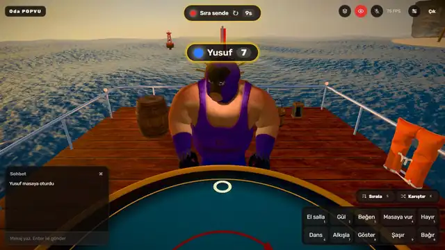</p>

---

## Masa temaları

Oda sahibi lobide 10 temadan birini seçer. Kapalı mekânlar loş ve sıcak, açık hava temaları gerçek gökyüzü panoramaları ve hareketli çevrelerle hazırlandı.

<table>
  <tr>
    <td width="50%"><br><b>Loş Meyhane</b><br>Tuğla duvarlar, fıçılar, raflarda şişeler ve tavanda sallanan fener.</td>
    <td width="50%">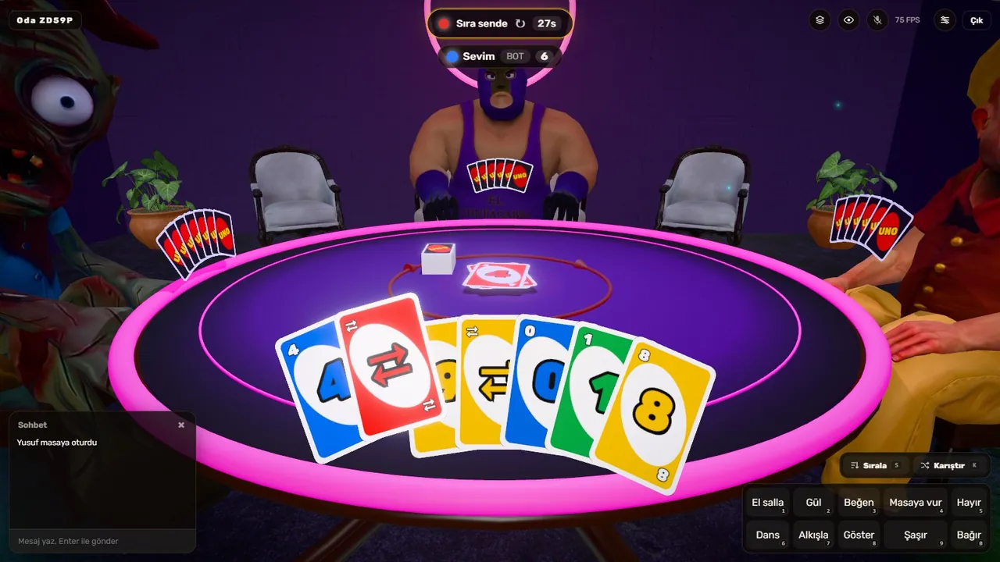<br><b>Neon Kulüp</b><br>Mor ışıklar altında parlayan pembe neon masa.</td>
  </tr>
  <tr>
    <td>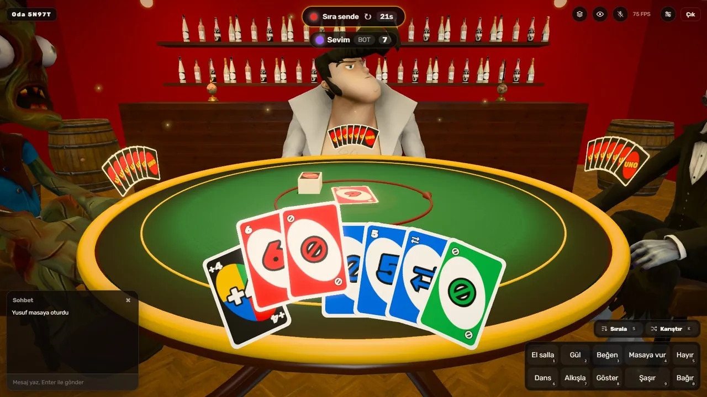<br><b>Kumarhane</b><br>Kırmızı duvarlar, yeşil çuha ve altın kenarlı masa.</td>
    <td>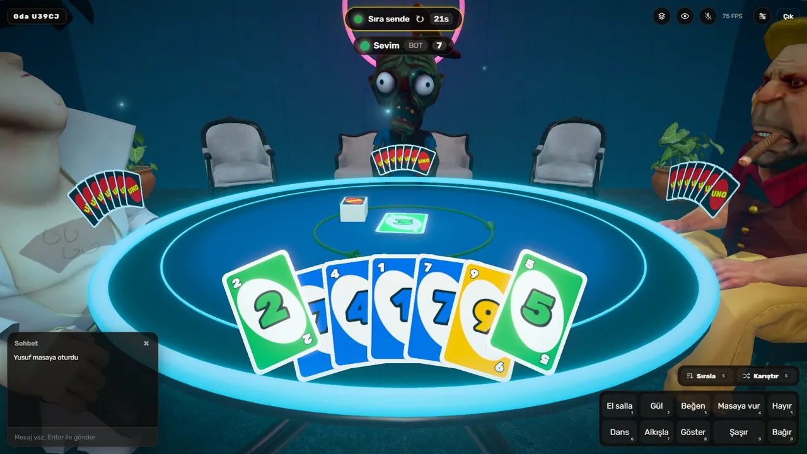<br><b>Gece Denizi</b><br>Turkuaz ışıkla aydınlanan serin, gece mavisi bir salon.</td>
  </tr>
  <tr>
    <td>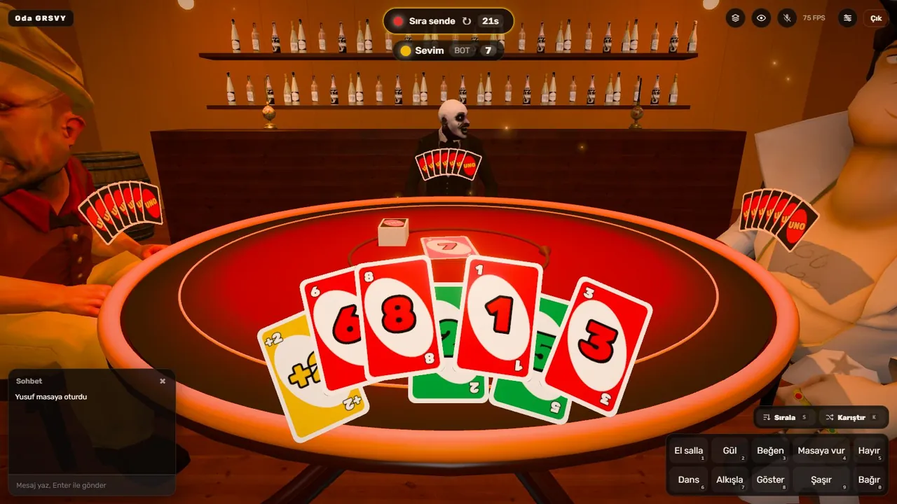<br><b>Çöl Gün Batımı</b><br>Turuncu gün batımı ışığında sıcak bir mola yeri.</td>
    <td>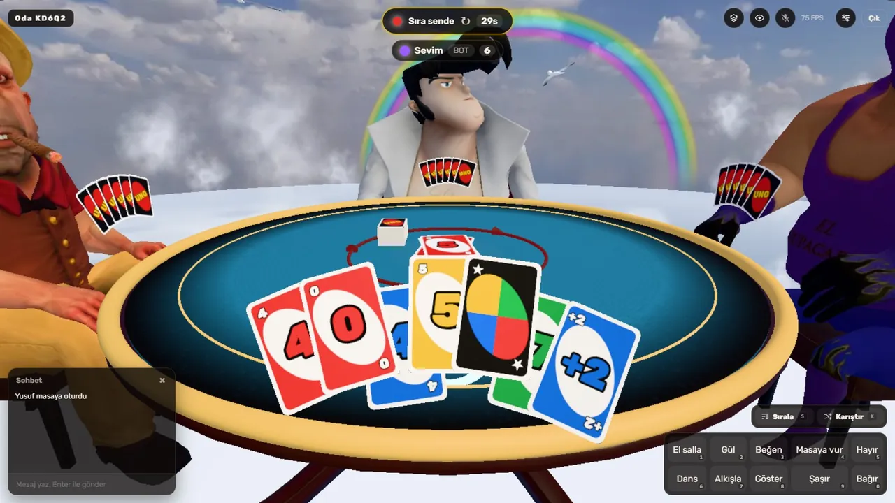<br><b>Bulutların Üstü</b><br>Bulut denizinin üstünde süzülen bir ada, martılar ve gökkuşağı.</td>
  </tr>
  <tr>
    <td>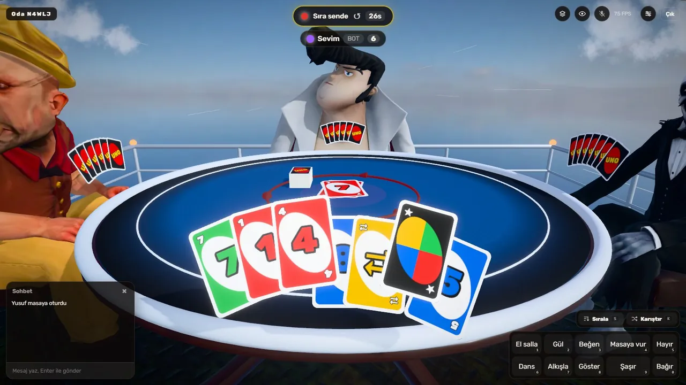<br><b>Uçağın Üstü</b><br>Bulutların arasından geçen bir yolcu uçağının sırtında oyun.</td>
    <td>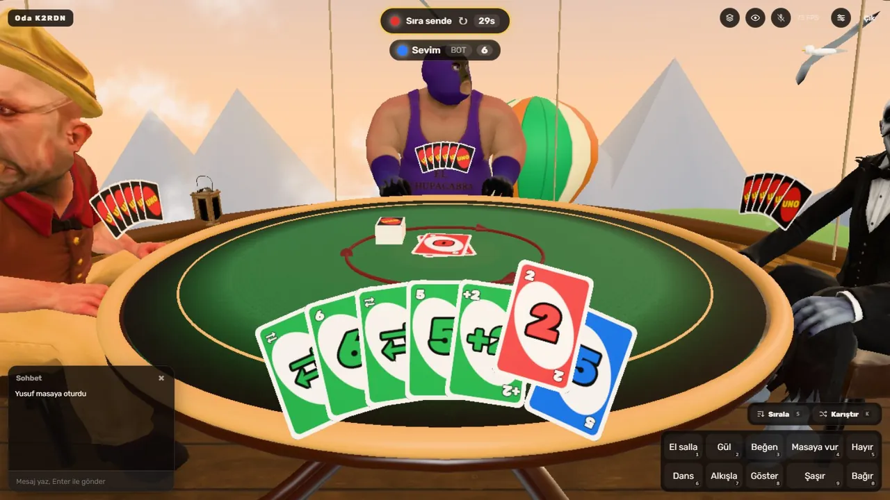<br><b>Sıcak Hava Balonu</b><br>Gün batımında dağların ve diğer balonların arasında yükselen sepet.</td>
  </tr>
  <tr>
    <td>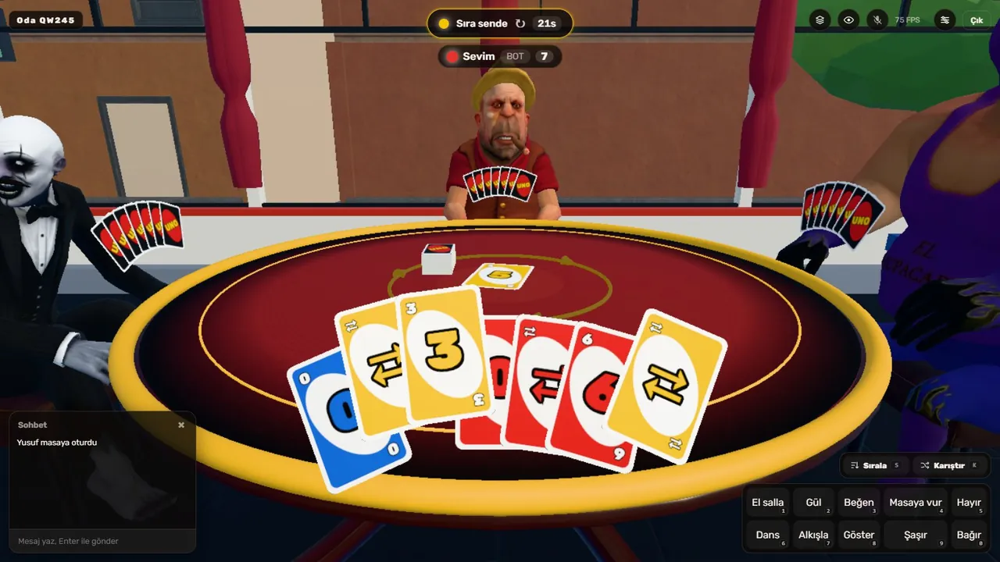<br><b>Otobüs Yolculuğu</b><br>Şehir caddelerinde akan trafik, dükkânlar ve tabelalar arasında yol alan otobüs.</td>
    <td>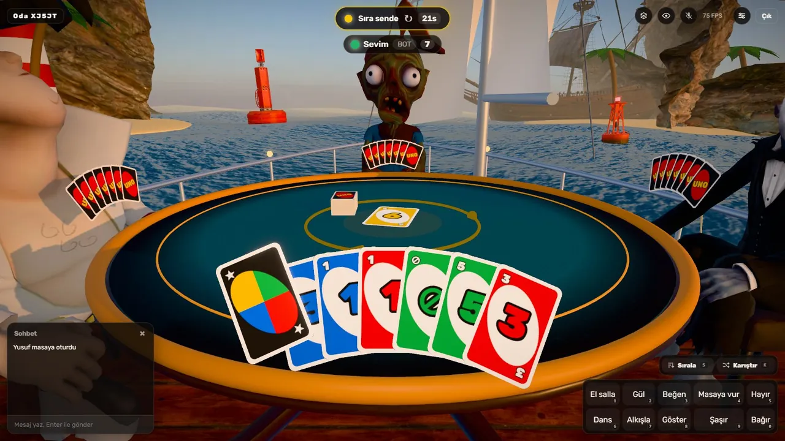<br><b>Tekne Gezisi</b><br>Dalgalı denizde adalar, şamandıralar, deniz feneri ve uzakta bir yelkenli.</td>
  </tr>
</table>

---

## Kontroller

| Tuş / Eylem | Ne yapar |
|---|---|
| **Fare** | Etrafa bak, kartın üstüne gelip tıklayarak at |
| `D` | Kart çek |
| `P` | Çektiğin kartı oynamadan sırayı geç |
| `S` | Elini renk ve sayıya göre sırala |
| `K` | Elini karıştır |
| `V` | Mikrofonu aç / kapat |
| `1` … `0` | Emote'lar: El salla, Gül, Beğen, Masaya vur, Hayır, Dans, Alkışla, Göster, Şaşır, Bağır |
| `Esc` | Renk seçimini kapat |

Sağ üstteki **Masaya yukarıdan bak** düğmesi masayı tepeden gösterir, **Kendimi izle** kendi karakterini dışarıdan gösterir. **Ayarlar** menüsünden ses, mikrofon ve grafik kalitesi (Düşük / Orta / Yüksek / Otomatik) değiştirilebilir; değişiklikler anında uygulanır.

---

## Kurulum ve çalıştırma

Gerekenler: **Node.js 20+** ve npm.

```bash
npm install
npm run dev
```

- Web: http://localhost:5173 (oyun sunucusu 3001 portunda çalışır, Vite bağlantıyı ona aktarır)
- Arkadaşını davet etmek için lobideki **Davet linkini kopyala** düğmesini kullan.
- Aynı bilgisayarda test etmek için iki ayrı sekme açman yeterli; her sekme ayrı bir oyuncudur.

### Diğer komutlar

```bash
npm test          # oyun kuralı testleri
npm run typecheck # tüm paketlerde tip kontrolü
npm run build     # web uygulamasını derler; ardından `npm start` hem sunucuyu hem web'i 3001'de yayınlar
```

---

## Proje yapısı

| Klasör | İçerik |
|---|---|
| `packages/engine` | Oyun kuralları (saf TypeScript, testli): kart etkileri, sıra, otomatik UNO, puan, botlar |
| `packages/protocol` | İstemci ↔ sunucu mesajları (zod ile doğrulanır), temalar ve emote listesi |
| `apps/server` | Node + Socket.IO: odalar, hızlı eşleşme, botlar, süre, yeniden bağlanma, sesli sohbet sinyali |
| `apps/web` | React + React Three Fiber: 3D masa, karakterler, kart animasyonları, temalar, arayüz |

Oyun mantığı tamamen sunucuda çalışır; istemci yalnızca kendi görmesi gereken bilgiyi (kendi eli, diğerlerinin kart sayısı) alır. Böylece kimse başkasının kartlarını göremez.

### Karakter ekleme

Mixamo karakterlerini ve animasyonlarını eklemek için: [apps/web/src/assets/README.md](apps/web/src/assets/README.md)

---

## Teknolojiler ve emeği geçenler

- **[React Three Fiber](https://r3f.docs.pmnd.rs/)**, **[drei](https://github.com/pmndrs/drei)**, **[three.js](https://threejs.org/)** ve **postprocessing**: 3D sahne
- **[Socket.IO](https://socket.io/)**: gerçek zamanlı çok oyunculu bağlantı
- **[Zustand](https://github.com/pmndrs/zustand)**: arayüz durumu
- **[Vite](https://vite.dev/)**: geliştirme ve derleme
- **[Mixamo](https://www.mixamo.com/)**: karakterler ve animasyonlar
- **[Poly Haven](https://polyhaven.com/)** (CC0): 3D modeller, yüzey dokuları ve gökyüzü panoramaları
